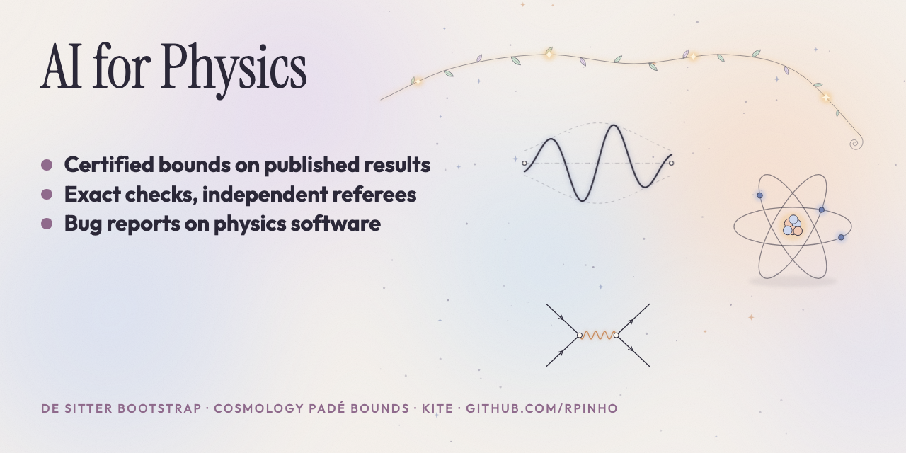

# ai-physics

**AI for Physics.**

Physics results I've run with AI agents, in one place. Every item names the published paper it starts from, what was asked, what we found, how an independent referee checked it, and where it is still a candidate. All of it has been sent to the author it concerns.

Sister hubs: [AI for biology](https://github.com/rpinho/ai-biology) · [math](https://github.com/rpinho/math-certificates) · [astronomy](https://github.com/rpinho/planet-hunt)

## What this is, and what it isn't

A physicist I studied with put the objection plainly: a number alone isn't worth much without new physics or new intuition behind it. I think he's right, and most of what is below is a tightening, a closed form or a software defect rather than new physics. It is labelled that way.

Brian Armstrong's November 7 [post](https://x.com/brian_armstrong/status/2119150702446420027) is the format argument: every experiment as a repo, data and code versioned, replication rewarded. Agents make the search cheap, so what matters is whether anyone else can rerun the check. Each folder here holds the claim, the primary-source derivation, the referee's verdict, and the checker the referee wrote without the finder's code.

**Referee verdicts** are the separate agent's words: HOLDS, HOLDS WITH CAVEATS, CONFIRMED, CONFIRMED-MINOR. Nothing here has been refereed by a journal, and no priority is claimed.

## Results

### João Penedones — de Sitter bootstrap bound

- **Paper:** Hogervorst, Penedones and Salehi Vaziri, *Towards the non-perturbative cosmological bootstrap*, [arXiv:2107.13871](https://arxiv.org/abs/2107.13871), equation (5.53).
- **Asked:** can the printed bound be improved, with a certificate?
- **Found:** 5.67049 → **5.45808**, with an independent interval certification over all 61 closed intervals of the spectrum.
- **Checked:** HOLDS WITH CAVEATS. The referee rebuilt the functional from the paper with 640-bit Arb arithmetic and explicit truncation bounds, and its trivial controls fail where they should (a single degree-1 term gives 10.876; deleting degree 5 looks better but breaks positivity at n=6). The caveat: the eight functionals behind the paper's printed 5.67049 aren't public, so the baseline comes from the paper rather than a rerun.
- **Honest framing:** this is a numerical tightening of a demonstration bound, not new physics. [Claim, derivation, referee](friends/penedones-de-sitter-bootstrap/).

### Pedro Vieira — a closed single-light-cone seed, and what its ODE is

- **Paper:** Olivucci and Vieira, *Stampedes I*, [arXiv:2111.12131](https://arxiv.org/abs/2111.12131), section 4 and appendix E, which asks for a closed resummation of the single-light-cone seed series.
- **Found:** a closed form for that seed (X004), after all 30 entries of the paper's printed table were reproduced first. HOLDS WITH CAVEATS: it reformulates an existing exact determinant (Kostov, Petkova and Serban, [arXiv:1905.11467](https://arxiv.org/abs/1905.11467)) rather than extending its coverage.
- **Follow-up, after the two questions that came back:** the result is not in *Stampedes II*, and the ODE is exactly the zero-angular-momentum radial Coulomb scattering equation in two dimensions, with L as radius, B as charge and energy π². That gives a logarithmic Coulomb phase and shows increasing B delays every positive zero; its double-scaling limit recovers the Bessel seed of *Stampedes II*. A separate referee agrees with the algebra and the limits.
- **Honest framing:** explanatory consequences of an existing seed, not a new physical discovery. [X004](friends/vieira-stampedes-seed/x004/) · [the Coulomb follow-up](friends/vieira-stampedes-seed/coulomb-follow-up/).

### Artur Alho — Signorini balls and certified Padé approximations

- **Papers:** Alho and Calogero, [arXiv:1907.09970](https://arxiv.org/abs/1907.09970) §6.4; Alho, Hell and Uggla, [arXiv:1503.06994](https://arxiv.org/abs/1503.06994), Table 1; Alho and Uggla, *New simple and accurate quintessence approximations*, [arXiv:2407.14378](https://arxiv.org/abs/2407.14378).
- **Found:**
  - **O004 (HOLDS):** an existence theorem where the published work left numerical evidence — for every −1 < ν < 1/2 and every prescribed δ_c > 1, a strongly regular static quasi-linear Signorini ball with finite radius, positive density and positive interior principal pressures.
  - **O010 (HOLDS WITH CAVEATS):** the n = 20 [4/4] Padé approximant gives a certified relative Hubble error below 0.000067% at the same endpoint where the paper's best printed row has 31%, with n = 30, 50 and 100 rows added. Exact rational certificates, no fitting.
  - **O011 (HOLDS):** certified uniform error bounds for the tracking approximation over the full interval 0 ≤ z ≤ 6: Ω_m below 0.0014% and E below 0.0007% for both p = 1 and p = 1/10. The normalization change from the source is disclosed and controlled separately.
- [Claims, proofs, certificates and verdicts](friends/alho-signorini-and-pade/).

### Tiago Fonseca (with Paul Zinn-Justin) — a fused-link obstruction

- **Paper:** Fonseca and Zinn-Justin, *Higher spin polynomial solutions of the quantum Knizhnik–Zamolodchikov equation*, [arXiv:1212.4672](https://arxiv.org/abs/1212.4672), appendix C.2.
- **Found:** W011, an exact counterexample to the literal reading of the fused-link map at the special q, with the ordinary Chevalley-generated algebra. At ℓ = 3, L = 6 the image dimension is 34 against 35 strict-weight-zero ordinary invariants.
- **Checked:** HOLDS WITH CAVEATS, reconstructed independently. The caveat matters: it is an obstruction for the ordinary algebra form, and is not a counterexample if the intended codomain uses Lusztig's divided powers. [Claim, audit, verdict](friends/fonseca-dinis-qkz-fused-link/).

### Aires Ferreira — KITE

- **Who and what:** [Aires Ferreira](https://www.york.ac.uk/physics/people/ferreira/), University of York; [KITE](https://github.com/quantum-kite/kite) is the open quantum-transport code he co-develops ([Comput. Phys. Commun. 2020](https://doi.org/10.1016/j.cpc.2020.107676)).
- **Found:** 4 confirmed bugs on a fresh clone. The top one: KITE-tools prints the temperature read from the file and then ignores it in both optical-conductivity branches, so finite-temperature optical results are computed at the wrong temperature. Also: a nonzero onsite energy shift invents interorbital couplings even for diagonal matrices; the documented Green LDOS kernel is too large by a factor of π; a non-divisible moment count silently loses its remainder across threads. One further candidate was judged intended behaviour and dropped.
- **Checked:** a separate referee reproduced each on its own clone, reading only the claim document — [verdicts and ranking](friends/ferreira-kite/VERDICTS.md), [patch](friends/ferreira-kite/combined.patch).

### Carlos Guedes — Duflo and symmetric quantization maps, a correction

- **Paper:** Guedes, Oriti and Raasakka, *Quantization maps, algebra representation and non-commutative Fourier transform for Lie groups*, *J. Math. Phys.* 54 (2013), [arXiv:1301.7750](https://arxiv.org/abs/1301.7750), section 5.2.
- **Found:**
  - **CG004 (HOLDS):** the printed symmetric and Duflo cubic examples don't follow from the paper's own defining maps. An erratum-type result, read against the arXiv v2 and the journal version.
  - **CG456 (HOLDS):** the corrected and extended coordinate-word table through length 4; all 360 inverse images agree exactly with an independent rebuild.
- **Honest framing:** a correction to worked examples, not to the paper's main construction. [Claims and verdicts](friends/guedes-flm-identities/).

## Not here

- Results that have not been sent to the author they concern.
- Mathematics that happens to be done by physicists lives in the [math hub](https://github.com/rpinho/math-certificates); the TESS exoplanet search lives in [planet-hunt](https://github.com/rpinho/planet-hunt).

## How this was run

AI agents under a bounded harness, [rstack](https://github.com/rpinho/rstack): the claim and its kill line are frozen before the search, the published baseline is reproduced first, the referee is a different agent on a different model that may not import the finder's code, and prior art is re-run rather than quoted.

## References

Everything here builds on other people's papers and code.

- Brian Armstrong, [publicly funded science as open source](https://x.com/brian_armstrong/status/2119150702446420027), November 7, 2026.
- Hogervorst, Penedones and Salehi Vaziri, [arXiv:2107.13871](https://arxiv.org/abs/2107.13871).
- Olivucci and Vieira, *Stampedes I*, [arXiv:2111.12131](https://arxiv.org/abs/2111.12131); Kostov, Petkova and Serban, [arXiv:1905.11467](https://arxiv.org/abs/1905.11467).
- Alho and Calogero, [arXiv:1907.09970](https://arxiv.org/abs/1907.09970); Alho, Calogero and Liljenberg, [arXiv:2104.11131](https://arxiv.org/abs/2104.11131); Alho, Hell and Uggla, [arXiv:1503.06994](https://arxiv.org/abs/1503.06994); Alho and Uggla, [arXiv:2407.14378](https://arxiv.org/abs/2407.14378).
- Fonseca and Zinn-Justin, [arXiv:1212.4672](https://arxiv.org/abs/1212.4672), *Comm. Math. Phys.* 328 (2014) 1079–1115.
- João, Anđelković, Covaci, Rappoport, Lopes and Ferreira, KITE, [*Royal Society Open Science* 7:191809 (2020)](https://doi.org/10.1098/rsos.191809).
- Arb/FLINT for the interval arithmetic behind the certificates.
- Anthropic Economics, [AI for scientific discovery: how researchers use Claude](https://www.anthropic.com/research/how-researchers-use-claude), November 5, 2026 — physics and astronomy at 40% of researcher time, against 32% for biology.
